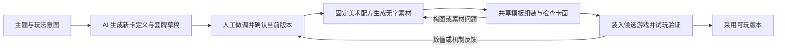

# 卡牌生成工作流：从卡组设计到可玩版本

2026-09-26。状态：设计提案，已核对 Worka 与 CardGame 当前源码及相关工具的官方文档；尚未实现、启用或运行这条完整工作流。本文中的新接口、字段和文件组织均为建议，不代表现有能力。

## 推荐决策与本次要求

采用“结构化卡组设计 → 人工微调 → 无字素材 → 固定模板组装 → 候选游戏验证”的主流程。第一条素材配方采用 2D；需要同一角色、法器的多角度或动画复用时，增加 3D 建模后渲染的配方。两种配方交付相同的卡图接口，后续组装与游戏接入共用。

本次用户要求与验收目标：

- 能在卡牌工作台反复新建并运行同一种工作流，保留批次、版本与结果。
- 包含 AI 生成卡组、人工微调、生成素材、组装牌面、加入游戏五个环节。
- 人工微调是正式输入；后续生成、重试和旧任务回执不能覆盖它。
- 认真比较 2D 与 3D 路线，以可用成品、返修次数和复用收益选择。
- 生成素材及组装由 AI 和工具完成，用户不用补帧、抠图、整理文件或学习建模。
- 沿用现有便笺身份、内容源、版本、执行台、候选登记、采用和试玩能力。
- 能证明卡牌进入真实加载链且行为可用；“生成完成”“资源采用”“进入游戏”分别记录。

“卡组”暂按“设计一套新卡，并给出引用这些卡的可玩套牌”理解。美术暂沿用已有设计中的像素资源方向和游戏的修仙题材；最终颗粒度、构图及是否采用插画风由小样确定。若需求只是从已有卡池组牌，直接复用卡牌与素材，跳过不需要的生产环节。

## 当前基础与明确缺口

| 已核对的现状 | 对设计的影响 |
| --- | --- |
| [生产 actions](../../templates/cardgame-production/actions.ts) 已有草稿、生成、新轮次、回执、候选登记和采用 | 扩展生产便笺，继续由执行台运行工作 |
| [工作流后端](../../plugins/cardgame-content/src/workflow.ts) 保存 requirement snapshot、revision、requestId、round、stale 回执 | 复用这些身份与重试规则，补充批次和阶段间的关联 |
| `workflowStatus` 的 `generationCapability` 当前为 `unknown` | 交办路线存在不能证明图像或 3D 提供方已接通 |
| [内容后端](../../plugins/cardgame-content/src/content.ts) 支持已有卡牌的版本检查、JSON 更新及引用校验 | 新卡草稿、创建和批量发布仍需明确接口；不能把 updateCard 当成创建接口 |
| CardGame 的 `BaseCardSprite` 定义 180×260 逻辑尺寸，派生类动态绘制名称、种族、星级、攻防等 | 继续保留动态文字与数值，扩展共享展示层接入插画 |
| 游戏的 `BaseCard` 没有统一插画引用字段；Worka 当前卡牌网格也没有调用游戏渲染器 | 需要同时接通卡牌数据、资源解析、游戏渲染和 Worka 卡面预览 |
| 内容后端识别若干字符串形式的图片字段；`card-missing-art` 当前只检查已有图片引用是否失效 | 不能用现有巡检证明每张新卡都有插画；新流程要检查素材必需项 |
| 游戏 `CardSpriteFactory` 支持单位、法器、符箓、法阵、丹药；类型中另有 skill | 第一批限定实际支持的卡种；不能把类型声明当成可用实现 |
| 功法执行 registry 只覆盖部分动作，未知动作会 warning 并返回未执行 | 生成时约束机制词汇，并用运行证据验收；合法 JSON 不等于有效机制 |
| 已有资源采用清单与游戏 `content-catalog.json` 各自承担不同职责 | 采用资源后仍需更新卡牌引用、卡组登记、加载和纹理解析 |

Worka 主干职责保持 [当前架构](../architecture.md) 的边界：DSH 持有模型、凭证、会话与进程生命周期；CardGame 扩展保存业务事实；便笺呈现和调用公开能力。现有未提交工作不属于本提案的改动。

## 五步流程与人的参与

| 阶段 | 可检查的产物 | 通过条件与用户动作 |
| --- | --- | --- |
| AI 设计 | 新卡定义、套牌 `{id,count}` 列表、设计意图、素材需求清单 | 全局 ID 不冲突；引用有效；机制有实现依据；说明组合方式、强弱点与待验证假设 |
| 人工微调 | 当前草稿和相对上一版的差异 | 在卡牌库直接改少量值，或通过本便笺对话批量修改；说“按这版继续生成素材”即可固定输入版本 |
| 生成素材 | 每张卡的有限候选、采用的素材版本、生成记录 | 素材尺寸、主体与风格满足配方；技术检查通过后按批次策略推荐或自动采用，可否决返修 |
| 组装卡面 | 游戏渲染器导出的卡面、全套联系表、布局检查结果 | 中文、长名、长效果文字、图标、裁切及动态数值区可读；失败回到相应步骤 |
| 加入游戏 | 候选版本、卡组入口、加载清单、试玩与行为证据 | 能找到牌、抽到牌、使用牌并触发预期行为；正式采用记录确切版本 |

人工微调后只保留一个明确的“继续制作”节点；不要求逐卡确认或每步重复审批。第一次定义风格时建议看一次小样，已确认的配方可按既定范围继续批量生产。文件保存、打开便笺、查看候选本身不启动付费生成。

AI 设计先读规则、同类卡、机制实现和当前卡池，再提出卡组骨架：角色分工、数量、强度区间、配合关系、弱点和测试场景。优先使用现有可执行机制；需要新机制的卡单独标记，并把实现工作交给 Todo/执行台。不要默默用近似机制替代用户确认的设计。

## 素材路线：2D 主线，3D 按复用价值进入

下表是结合项目的工程判断，未经过本项目样本的质量、耗时或价格实测。

| 路线 | 适合内容 | 主要不确定性 | 建议 |
| --- | --- | --- | --- |
| 2D 参考图生成 | 静态人物、灵兽、符箓、法阵及场景卡图 | 角色身份与整套风格漂移，细节返修 | 第一条闭环采用这条路线 |
| 3D 模型 → 固定场景渲染 | 反复出现的法器、同角色多角度、未来角色动画 | 模型背面、薄片、手部、材质、姿态；动画还需要绑定验证 | 对有明确复用需求的资产先做少量对照 |
| 3D 构图 → 2D 风格化 | 需要固定角度与绘画质感并存的系列 | 最后一次生成仍可能改变轮廓或纹理 | 作为试验配方，保持同一验收口径 |

### 2D 配方

先建立一个小的美术参考包：认可的 3–6 张参考、色板、光线、视角、主体占比、边缘留白、背景复杂度和禁止项。参考可以由 AI 出样后选择；用户负责取舍即可。每次生成同时带上风格参考与主体参考，只更换该卡的内容描述。

- **像素风优先试 PixelLab。** 官方 API 有带风格参考的图片生成、角色与动画能力，异步任务可轮询。先验证静态卡图，不把动画能力直接视作可交付的战斗角色。参考应使用真实像素尺寸，避免把整数放大后的图直接当生成基线。[PixelLab API](https://api.pixellab.ai/v2/docs)
- **插画风或概念设计试 FLUX.2。** 官方 API 支持多参考编辑，适合用“主体参考 + 风格参考 + 构图参考”组织输入。批量配方固定模型版本与参数；保留原始输出，因为重复调用仍不应被当成像素级复现。[FLUX.2 图像编辑](https://docs.bfl.ai/flux_2/flux2_image_editing)
- **ComfyUI 是可选的制作后端。** 当需要固定多步加工或已有可用 GPU 服务时，把图像生成、遮罩、尺寸处理等存成版本化配方，通过 `/prompt` 提交并读取进度、history；模型、节点版本和依赖也需固定。第一版可以直接接一个图像 API，避免先承担节点部署与 GPU 运维。[ComfyUI 服务 API](https://docs.comfy.org/development/comfyui-server/comms_routes)

生成目标是无名称、无数值、无说明文字的卡图。普通插画窗口可直接用完整背景图，减少抠图需求；需要主体越过边框时才启用透明主体配方。像素配方单独固定逻辑像素网格、调色板与缩放规则；简单缩小一幅插画不能保证得到合格像素画。

每张首轮最多 2–3 个候选，先检查再扩展。单卡返修只改该卡；不因一张失败而重跑整套。角色变体引用同一主体基准，不能只依赖相同 seed 或一句“保持一致”。最终按游戏实际显示大小检查轮廓和识别度。

### 3D 配方

采用“已确认的概念图 → 图生模型 → 固定 Blender 场景 → 卡图”的链路。Meshy 官方提供图生 3D、多图生 3D、异步任务和 GLB 等输出；多图输入应是同一个对象的相容视图。它提供可接入的能力，不能据此保证模型符合本项目美术与动画要求。[Meshy 图生 3D](https://docs.meshy.ai/en/api/image-to-3d)、[多图生 3D](https://docs.meshy.ai/en/api/multi-image-to-3d)

Blender 场景预先固定相机、灯光、材质映射、色彩管理、尺寸和透明背景设置，由脚本导入模型并渲染。模型居中、尺度与朝向归一化；保存 GLB、贴图、场景、脚本和版本。相机可按系列固定为正交或透视，选择由小样决定。[Blender 命令行渲染](https://docs.blender.org/manual/en/4.4/advanced/command_line/arguments.html)、[相机](https://docs.blender.org/manual/en/4.4/render/cameras.html)

优先拿一件法器验证，再评估人物与灵兽；不要一开始给整套卡牌建模。静态卡图不必提前完成动画级拓扑与绑定；若目标包含动作或多方向 spritesheet，这些就成为新增的验收项。用户不承担模型修复：失败候选可由工具修复、重试或回到 2D 配方。

3D 的收益来自同一对象可重复渲染。只有确实需要角度、姿势或多处使用，且小样证明总返修成本可接受，才值得扩大。经 AI 风格化后的帧仍需检查时序一致性，不能把多张好看的单帧当成合格动画。

当前 Worka 媒体预览只接受图片、音视频等格式，不能直接假设 GLB 已可登记和预览。第一期展示渲染后的 PNG；模型源文件的登记、下载与关联需要显式扩展资源契约，不把模型伪装成图片。

## 卡面组装：保留图层，用同一渲染源验收

卡面分为三个独立版本：

1. **卡牌定义**：名称、卡种、机制、星级、攻防、说明及标签；战斗中的即时状态另行输入。
2. **美术素材**：卡图、可复用纹理、图标及必要的模型源文件，均引用确切资产版本。
3. **展示模板**：各卡种布局、字体、文字区规则、插画裁切、图标位置，以及 field/deck/hover 的显示方式。

游戏继续动态绘制文字、数值和状态。输出的整张 PNG 用于卡牌库缩略图、联系表和分享，不成为战斗数值的权威来源。调攻防或改文案只重新组装，不再生成插画；更换主体形象才重做相应素材。

建议在游戏侧抽取共享 `CardPresentation` 数据与布局，再由现有 `BaseCardSprite` / 派生卡牌和 `CardSpriteFactory` 消费。Worka 优先展示同一 Phaser 渲染器在隔离预览场景导出的卡面；同时保留进入真实互动预览的入口。这样卡牌库与游戏不会各维护一套卡面 CSS。若日后确需 SVG/Canvas 导出，仍消费同一展示契约并验证差异。

首期沿用 180×260 的逻辑比例，用 1×、2×等导出倍率对照；插画窗口和导出尺寸先由卡面小样确定，再反推素材规格。应完成“占位图 + 真实文案 + 真实卡种”的模板验证后，才生成整套素材，避免生成的构图放不进去。

必须接通的契约：

- 统一的插画引用与展示配置，建议包含 `assetId`、`versionId`、`contentHash`、裁切焦点及模板版本。字段位置在实现时与游戏类型、Worka 索引和资源解析一并确定；不要并存多个不一致的权威图片字段。
- 运行时解析到随候选版本一起交付的本地资源路径；卡牌不直接引用服务商临时 URL 或 Worka 签名媒体 URL。
- 中文字体随构建固定，导出等字体加载后再截图；长文案有明确换行、限制和失败诊断，不靠无限缩小字号。
- 将单位、法器、符箓、法阵、丹药，以及手牌、战场、卡组列表、悬停详情纳入同一接入清单，保留拖拽、状态、提示和原显示模式。
- 新卡缺图阻止“完整制作完成”；旧卡可保留可识别的占位回退，不能让整局因一张缺图崩溃。

## 在 Worka 沉淀什么

### 配方、批次、事实与产物

**配方**保存“以后如何再做一次”：规则输入范围、允许机制、素材规格、风格参考版本、提供方参数、组装模板、检查项、重试与预算策略。以游戏项目内的文件维护，版本随项目保存。自然语言指南说明如何使用，类型化配置承接可执行字段；不能只留一段长提示词。

**批次**保存“这次制作的是哪一套”：配方版本、主题、已选 cardId 集合、套牌清单、批准的定义版本、各阶段引用、当前阻塞项。批次是业务记录，关联现有制作单与执行任务。建议每张卡的素材制作沿用一个 production，每轮继续使用现有 round，而不是另造第二套生成记录。

**执行事实**继续归现有执行台和工作流后端：提交、正在执行、等待人工、失败、取消、过期和完成。新增阶段记录只保存依赖、输入指纹和结果引用；不接管宿主调度或重复保存日志。

**产物**保存可复用的实体：卡牌 JSON、套牌 JSON、采用的图像/模型、卡面预览、发布清单及检查证据。游戏最终内容归项目，未采用候选与执行记录归 Worka 数据目录；便笺 state 仅保存当前批次、查询和选中项，列表继续分页。

正式资源应保留源输出及制作元数据：提供方、模型版本、输入参考哈希、参数、原始文件哈希、加工步骤、使用条款来源和生成时间。生成可追溯不等于可逐像素重生；组装应在固定渲染环境和已保存素材上复现。

### 依赖失效规则

| 修改 | 必须更新的环节 | 可保留的产物 |
| --- | --- | --- |
| 攻防、数量、普通规则数值 | 定义校验、组装、套牌与行为验证 | 主体身份未变的插画 |
| 名称或文案 | 排版、预览和游戏候选；语义改变时重新判断美术需求 | 与新语义仍相符的素材 |
| 主体、服饰、标志性武器或整体风格 | 相应素材、卡面、候选游戏 | 未受影响卡牌及机制设计 |
| 裁切或模板布局 | 卡面与相关展示检查 | 卡图原件 |
| 仅套牌数量配比 | 套牌引用及数量检查、试玩 | 卡牌定义与卡面 |
| 提供方或模型版本 | 未来调用采用新配方版本 | 已固定采用的素材和已验证批次 |

分开计算 `definitionRevision`、`artBriefRevision`、资产版本和模板版本，避免所有改动共用一个粗粒度 hash。生成返回后检查其输入是否仍是目标版本，过期结果可以保留供比较，但不能自动替换当前产物。

### 人工修改与恢复

- AI 提交基于哪版内容必须可查。人工编辑形成新 revision；重生成只提交基于原版的 patch，通过三方差异检查再合并。人工修改过的字段保留，冲突显示具体字段。
- “继续制作”绑定明确的批准版本，之后修改使受影响阶段过期。已经发布或正在试玩的版本保持固定，不在一局中途替换规则或图片。
- 已完成的子任务可复用，关闭便笺不影响执行；暂停批次阻止后续新提交，并显示已经提交给提供方的任务是否仍运行。
- 传输重试沿用现有 requestId；外部生成还需保存 providerJobId。外部请求结果不明时先查单，不能假定 Worka 内部幂等即可防止服务商重复扣费。
- 给每张卡和每批次设置有限候选数、质量返修次数、预算与并发数。超限保留成果，清楚显示需要选择或调整的原因。

### 用户在哪里操作

以现有 **AI 资源生产便笺**承载“卡牌生成”工作流模板和批次进度。卡牌库仍是单卡审阅与轻量修改的入口，资源库仍是候选和版本入口，执行台仍是运行入口，试玩仍是体验入口。

展开页显示一条五步进度、当前批次的卡牌网格、待处理项与选中卡的差异/候选。提供“继续制作”“只重做选中项”“查看试玩”这些实际操作。批量意图、风格调整和返修要求走便笺原生对话，并携带选中 cardId、批次和版本；不新增聊天窗口或庞大的流程编辑器。

compact 只显示一个当前批次的阶段、已完成/总数、一个待处理原因及入口，尊重实例实际宽高。UI 实施时沿用现有图标、名称、深链接、HeroUI、主题及滚动规则，保留原生成、采用、否决与历史入口。深浅主题、窄屏、键盘与错误状态需要实际验收。

## “加入游戏”的完成定义

先在隔离候选工作目录制作和集成，保留源项目的当前版本。卡牌库查看候选时需要明确候选归属；现有后端以 projectId 绑定项目根，实施需复用宿主已授权的工作目录机制，增加明确的候选查询范围或登记候选项目。不能仅改前端 cwd 就声称卡牌库已经在编辑草稿。

集成至少完成：

1. 合并新卡到游戏实际读取的卡种集合，检测 ID 冲突，保存套牌对 cardId 的引用；重复条目的数量按游戏规则汇总检查，不自行改变教程的顺序语义。
2. 登记/更新 `content-catalog.json` 中对应的卡牌集合与 deck 资源，保持 resourceId、路径和领域 ID 的区别。现有 catalog 无专门图像 kind，不能直接塞入未经支持的新 kind。
3. 同批交付资产清单、插画引用和文件，确保 Phaser 的纹理加载与缓存键包含版本信息；更换版本后不继续显示旧纹理。
4. 提供明确可达的试玩卡组或测试入口；仅把新卡写进卡池不能证明玩家能得到它。
5. 核对卡组列表、手牌、出牌、状态更新与悬停详情；为涉及的机制运行确定性场景，记录预期与实际变化。
6. 交付确切候选 revision 与检查证据，再按已授权范围采用。失败保留上一可玩版本；回退同时恢复定义、套牌、素材和模板引用，不能只换一张图。

平衡性与玩法趣味属于进一步的试玩判断。AI 的强度分析、格式校验、跑通一局各自说明覆盖范围，不能合并成“整套已平衡”。

## 先用一个小批次消除不确定性

建议以 6 张不同的卡作为样本：2 张单位、1 张法器、1 张符箓、1 张法阵、1 张丹药。它们是 6 个不同定义，套牌张数和重复数量由游戏现行规则另定。包含一个长名称、一段较长效果、一对需要保持同一主体身份的变体；允许复用现有定义做技术验证，不把技术样本自动当成正式新卡。

按这个顺序推进：

1. **模板先行。** 用占位图和真实文字跑通共享卡面与游戏入口；确定图窗比例及素材规格。这一步不依赖选哪家生成模型。
2. **2D 基线。** 按暂定像素方向完成 6 张静态卡图，每张首轮最多 2 个候选；若用户选择插画风，切换为插画配方，流程与卡面不变。
3. **3D 对照。** 仅对同一法器制作一次模型并导出多个角度，使用相同卡框和实际尺寸与 2D 比较；有明确角色复用需要时再加一个角色样本。
4. **贯通修改。** 人工修改一张卡的数值，一张改主体，一张改裁切，验证分别只触发应该发生的重做。
5. **实际使用。** 在候选版本中查看、抽取、打出并核对机制，完成采用及回退演练后再扩大批次。

比较记录包含：实际费用、含排队的总耗时、候选数量、返修次数、用户挑选用时、真实尺寸可读性、系列风格与主体一致性、额外角度/动作的复用结果。评估每张**通过验收**的卡的成本，包含失败候选与加工；不按单次 API 标价排序。预算、GPU 与服务账号尚未核定，本轮未调用付费生成。

建议第一轮硬性门槛：样本全部可达且缺失资源为零；人工值在返修后保持；长文案无溢出；中断恢复不重复采用；切换版本不串素材；真实战斗动态值可见。2D 与 3D 的视觉优劣由同尺寸对照决定，不预报成功率。

## 实施顺序与验证边界

| 实施块 | 主要归属 | 最小验收 |
| --- | --- | --- |
| 卡图引用、共享模板、真实预览导出 | 游戏展示层 + Worka 卡牌库 | 占位图贯穿卡牌库、卡组、手牌、战场与详情，动态数值保留 |
| 配方和批次、草稿版本、人工继续节点 | CardGame 扩展 + 生产/卡牌库便笺 | 一批能保存、修改、恢复；旧回执不覆盖人工版 |
| 一个 2D 提供方接入 | 独立 DSH 扩展/提供方 + 现有执行台 | 能力探测、真实提交、产物下载、登记、失败与费用事实 |
| 候选集成与试玩 | 游戏数据/加载层 + 现有预览适配器 | 内容清单、资源、可达卡组和行为证据指向同一 revision |
| 3D 可选配方 | 模型提供方 + Blender 工具链 | 一个资产的多视角复用收益经对照确认 |

第一期不建设通用节点编辑器、所有模型适配器、自动绑定动画或全套卡牌平衡平台。先把一个批次的五步做实，再将验证过的参数固化为可复用配方。

本次实际完成了代码与官方文档核对、路线选择、流程/数据/版本边界设计及知识库文档入口。未进行真实图像生成、3D 建模、游戏卡面改造或完整流程运行；未检查修改后的 UI 深浅主题和窄屏，因为本次没有实现 UI。后续逻辑改动只运行直接相关测试，并分别记录真实生成、真实游戏交互与隔离验证的证据。
# 已落地的第一期（2026-09-26）

五步流程已接入 `cardgame-production`，卡牌库“制作卡面”复用相同卡牌 ID 与制作单。卡组草稿使用便笺原生 AI 会话；确认、Codex 生图交接、回填、模板组装和加入游戏分别保留状态。插画提供方由用户选定为 Codex 内置 imagegen，当前通过可追踪请求回填，不声称 Worka 可直接远程调用当前会话的生图工具。

`plugins/cardgame-content/src/card-pipeline.ts` 编排现有 workflow 和 content 服务，不新增便笺私有数据库。每张卡保留源版本、人工确认指纹、插画要求/请求/素材版本、presentation、组装指纹和入库回执。旧请求、过期编辑和被外部修改的游戏数据均不能被覆盖。已采用资源使用内容指纹路径；流程中断后可识别已经写入的同一张卡。

`templates/cardgame-production/card-face.ts` 是模板布局源，现有青玉与宣纸两个不同布局。同一次组装生成两个主题的完整预览和不含静态攻防的游戏贴图。改数值需重新确认和组装，保留插画；改插画要求需新生图请求；切换已组装主题不调用模型。CardGame 的 `CardSprite` 读取 `cardFace`，显示动态攻防，缺失或加载失败时沿用原有牌面。

第一期支持单位卡。新卡加入 `units.json` 后进入运行时卡牌数据；掉落、商店、初始牌组和新增机制仍需对应游戏配置/实现，不能因卡面生成成功而声称玩法已验证。AI 批量生成未在真实模型上验收；相关验证记录应区分隔离测试、已确认样卡和真实模型调用。

以下为最初的整体方案，3D、多卡种及完整候选试玩仍属于后续范围。
